# Dados de Vendas · Plataforma de Fechamento + Dash de Vendas

**Margem real por pedido, loja, canal e SKU numa operação com seis marketplaces, com cada número rastreável até o arquivo que o originou.**

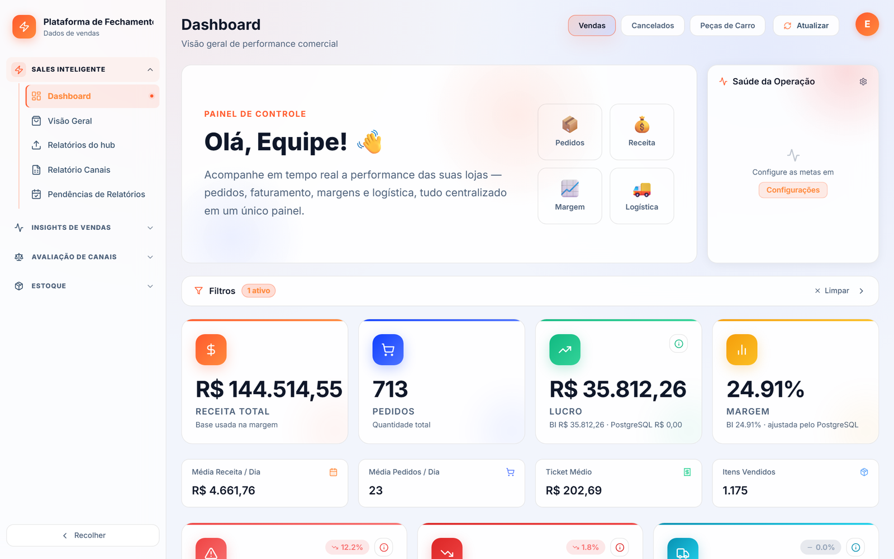

> Esta página reúne dois sistemas construídos para a mesma operação de e-commerce: a **Plataforma de Fechamento**, que calcula o resultado de cada pedido e apoia a decisão comercial e de compras, e o **Dash de Vendas**, um ETL diário que consolida as vendas no BigQuery e gera a curva ABC por loja e mês.

---

## O problema

Quem vende em vários marketplaces vê o faturamento todo dia, mas raramente vê o lucro. Cada canal cobra e repassa de um jeito:

- **comissões e taxas de serviço** com regras e sinais diferentes por canal;
- **subsídios, cupons e cashback** pagos pela plataforma que não aparecem no total do pedido;
- **reembolsos** lançados semanas depois da venda;
- **frete** cobrado do comprador diferente do frete faturado pela transportadora, envio próprio (Flex) sem reembolso, fulfillment com alíquota diferente;
- **custo do produto** que muda com o tempo e precisa valer na data da venda.

O fechamento mensal acontecia em planilhas: dias de trabalho, números diferentes em cada relatório e erros que não aparecem, como um valor sem centavos lido como mil vezes menor ou pedidos cancelados entrando na receita. Na compra, a mesma falta de visão: produto em ruptura vendendo menos e produto parado prendendo capital.

## A solução

| | Plataforma de Fechamento | Dash de Vendas |
|---|---|---|
| **O que é** | Aplicação web com login, permissões por tela e processamento em fila | ETL em Python empacotado como executável |
| **Entrada** | Relatórios do hub de marketplaces (itens e financeiro), relatórios financeiros dos canais, fatura da transportadora, planilha de custos e estoque | API do hub de marketplaces, exportações mensais, catálogo de custos e estoque (Bling ou planilha), relatórios da Shopee |
| **Saída** | Margem por pedido, loja, canal e SKU; diagnóstico de queda de vendas; ruptura, produtos sem giro e sugestão de compra | Base de vendas consolidada no BigQuery e curva ABC por loja e mês, pronta para painéis de BI |

A regra que guia os dois: **o número precisa fechar e precisa ser explicável**. Toda regra financeira está no código, testada e registrada em uma decisão de arquitetura; nenhum valor é estimado em silêncio.

---

## Funcionalidades: Plataforma de Fechamento

### Fechamento e margem por pedido

- Cálculo do resultado de **cada pedido**: receita, custo dos produtos na data da venda, comissão, imposto, frete pago pelo vendedor e pelo comprador, frete devolvido, diferencial de frete da transportadora, cupom e subsídio do marketplace.
- **Margem com uma única definição em todas as telas**: lucro ÷ total do pedido sem o frete pago pelo cliente. Lucro de um produto vem do rateio do pedido pela participação do item.
- Painel com receita, pedidos, ticket médio, lucro, margem, **pedidos em prejuízo e prejuízo acumulado**, comparativo diário com o mês anterior, participação e margem por canal, receita por loja e faturamento por modalidade logística.
- **Memória de cálculo** por pedido, campo a campo, para qualquer pessoa conferir de onde veio o lucro.
- Aba de cancelamentos com GMV cancelado, taxas e ticket médio cancelado, separada das vendas.
- Exportação para Excel com proteção contra injeção de fórmulas.

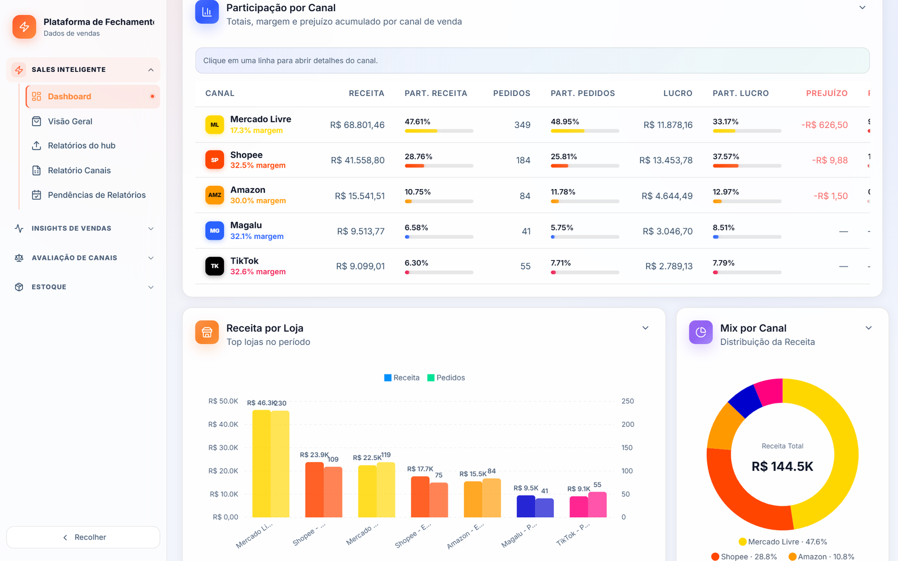

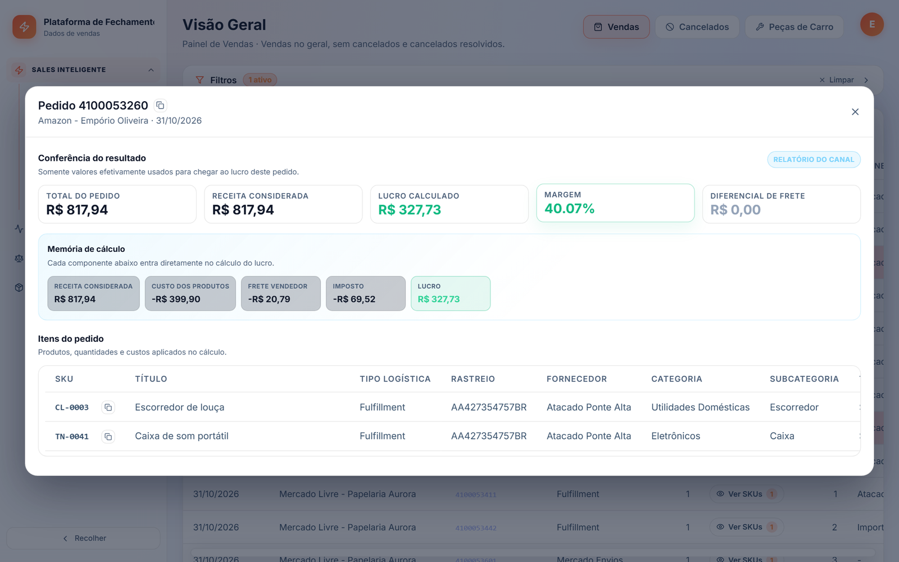

### Regras por marketplace, no código

Seis marketplaces têm tratamento próprio: **Mercado Livre, Shopee, Amazon, Magalu, Kabum e TikTok Shop**. Alguns exemplos de regras implementadas:

- **Subsídio da Shopee**: quando o relatório zera o cupom pago pela plataforma, o sistema reconcilia o rebate pelo valor econômico do próprio relatório e, se preciso, pelo financeiro do hub, sem contar o mesmo benefício duas vezes.
- **Comissão em três estados**: informada pelo canal (prioridade), zero explícito (válido) e ausente. Só a ausência recebe a média ponderada do próprio canal, que guarda base de pedidos, receita e comissão usadas no cálculo.
- **Reembolsos posteriores** da Amazon e da Kabum ficam fora do resultado da venda e continuam auditáveis na origem.
- **Diferencial de frete**: frete pago pelo comprador menos o faturado pela transportadora, positivo ou negativo, sem duplicar receita.
- **Envio Flex**: custo da entrega própria descontado do lucro, com o reembolso parcial de um canal e nenhum reembolso no outro.
- **Alíquota de imposto por loja e modalidade** (envio próprio ou fulfillment), com vigência e bloqueio de regras sobrepostas.

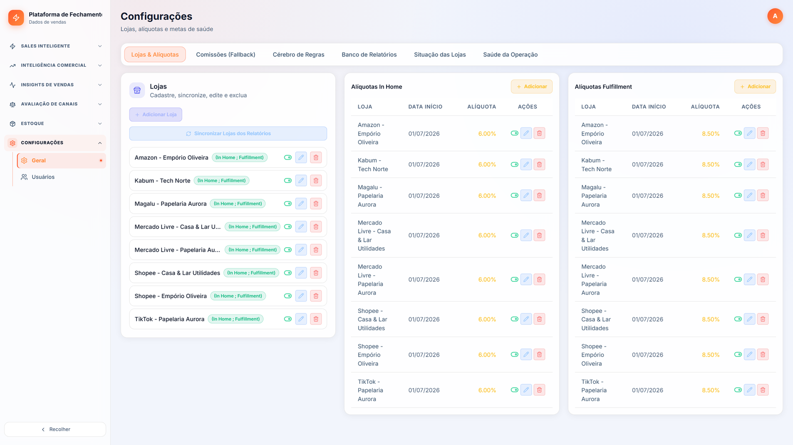

### Conciliação e qualidade de dados

- **Pendências de relatórios** por mês e loja: o relatório de itens e o financeiro precisam formar par. A tela mostra a cobertura do par, alerta abaixo de 95%, aponta meses com custo faltando e envios travados ou com falha.
- **Painel de envios** com status, período lido do arquivo, contagem de pedidos, recusa de arquivo idêntico (hash SHA-256) e aviso de arquivo enviado na loja errada.
- **Excluir, substituir e reprocessar só nos pedidos do arquivo**: o sistema desfaz o envio nos pedidos que ele trouxe e reaplica os demais envios na ordem original. Se faltar um arquivo necessário para reconstruir, recusa e explica.
- **Linhagem completa**: cada arquivo é guardado e suas linhas brutas ficam registradas; os fatos são uma projeção determinística dessas fontes.
- **Qualidade do cadastro**: SKUs duplicados, sem fornecedor, sem custo válido, sem categoria, estoque negativo e SKUs vendidos que não existem no cadastro.

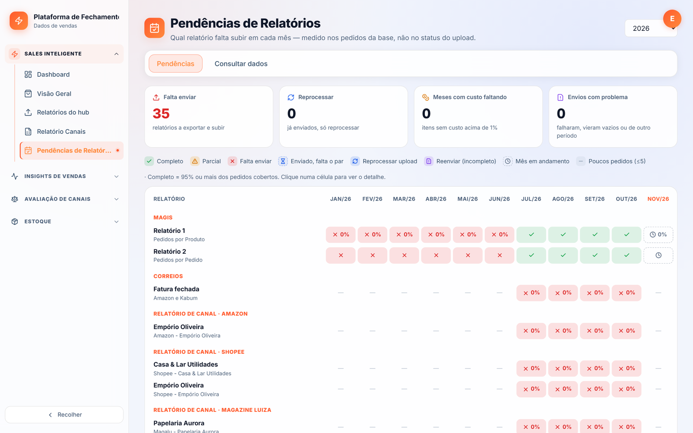

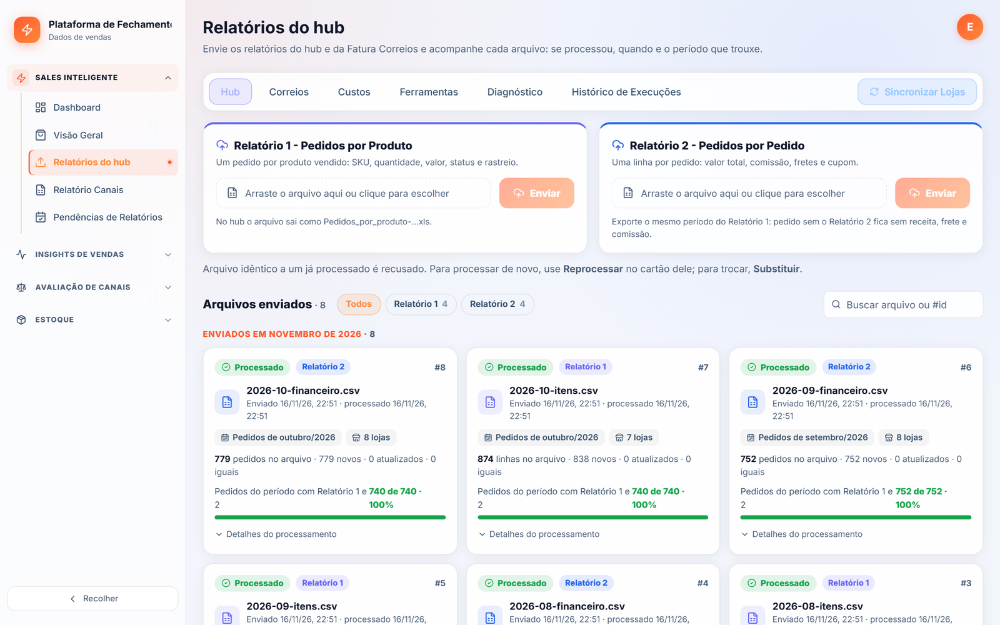

### Diagnóstico de vendas

- A variação de GMV entre duas janelas é decomposta por **lentes** (produto, loja, canal e logística). Cada lente soma exatamente a variação total, com fórmulas publicadas: `ΔGMV = ticket anterior × Δpedidos + pedidos atuais × Δticket`.
- Causas priorizadas por peso na queda (P1, P2, P3) e com **nível de confiança da evidência**.
- **Ruptura só é afirmada com evidência de estoque.** Três estados distintos: ruptura confirmada, parou de vender com estoque e possível ruptura (estoque desconhecido).
- Todo percentual declara o denominador e todo comparativo declara as duas janelas comparadas.
- Realocação de produtos de lojas encerradas para os canais ativos, com o volume já absorvido medido e o recuperável rotulado como estimativa.
- Avaliação de canais com **margem ajustada** (lucro menos perdas de atendimento e erros operacionais) e faixas de saúde.

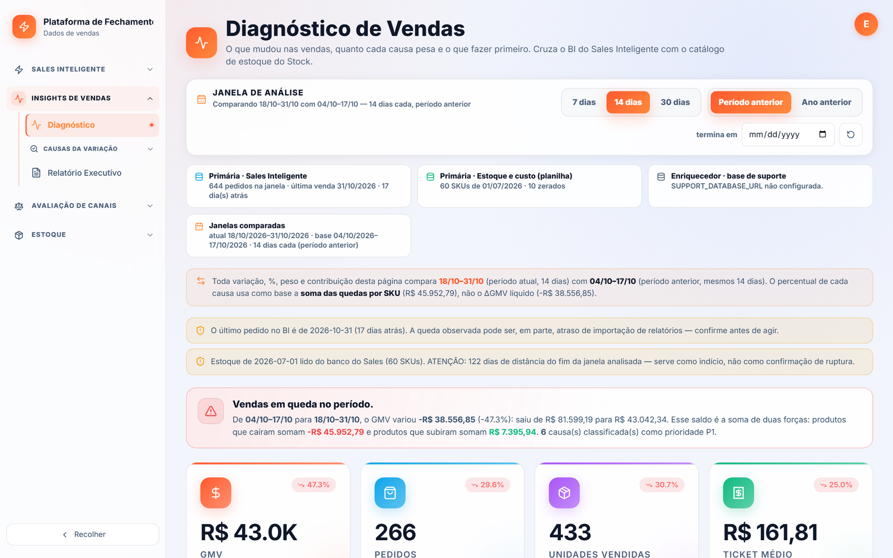

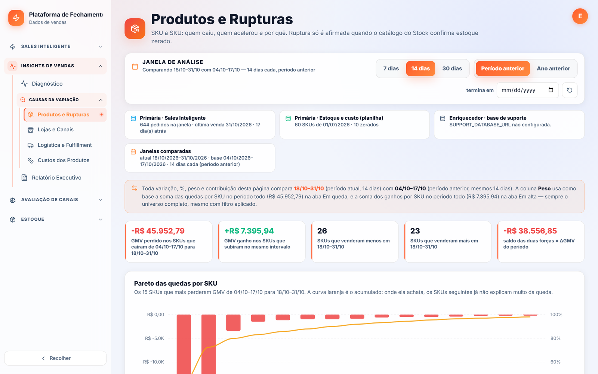

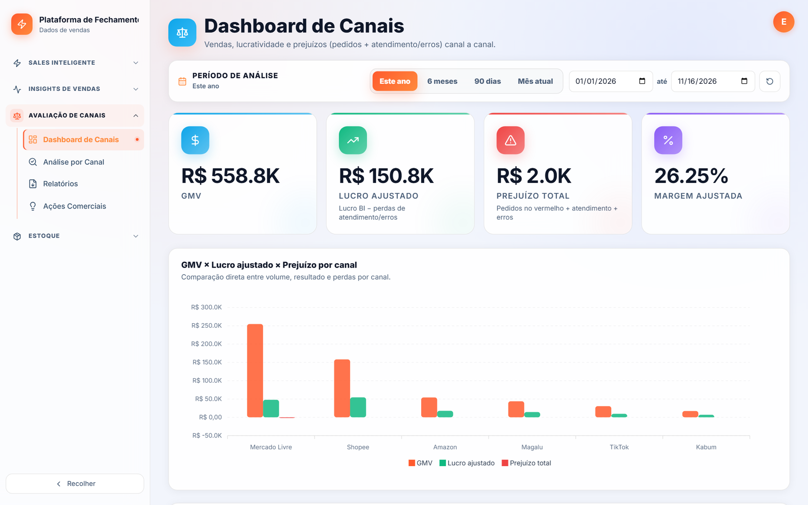

### Estoque, ruptura e sugestão de compra

- **Sugestão de compra** pela venda média diária do período, prazo de reposição, cobertura desejada e estoque de segurança, com custo de reposição e data prevista de ruptura.
- Situação de cada SKU: regularizar estoque negativo, ruptura, comprar com urgência, comprar em breve, avaliar compra, sem giro recente e estoque suficiente.
- **Produtos sem giro**: faixas de dias sem venda (7, 15, 30, 45, 60, 60+ e sem histórico) e o capital parado nesses produtos.
- Histórico de estoque gravado por ponto de mudança, para saber **em que dia** um SKU zerou.

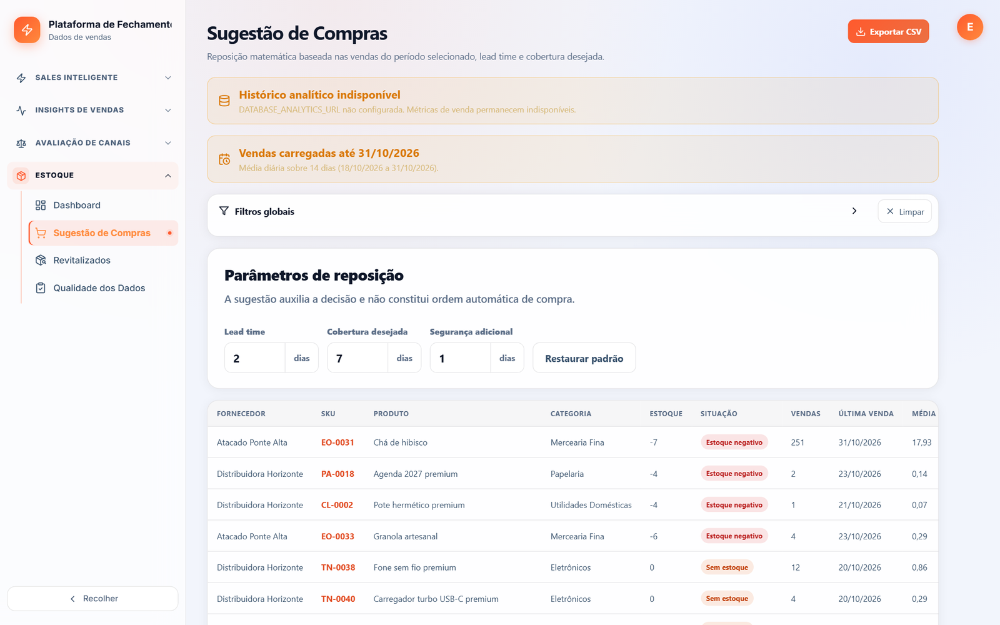

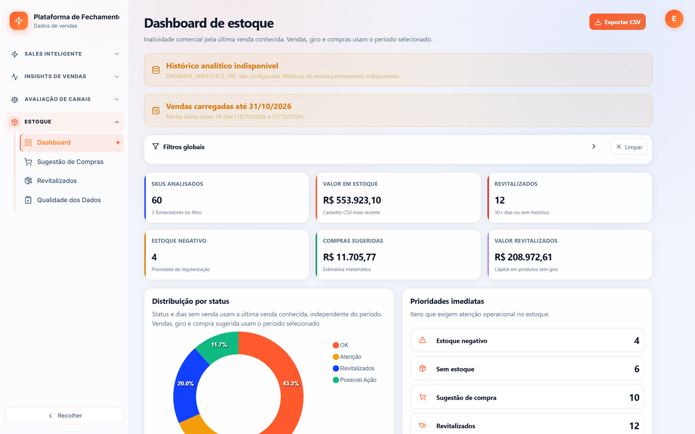

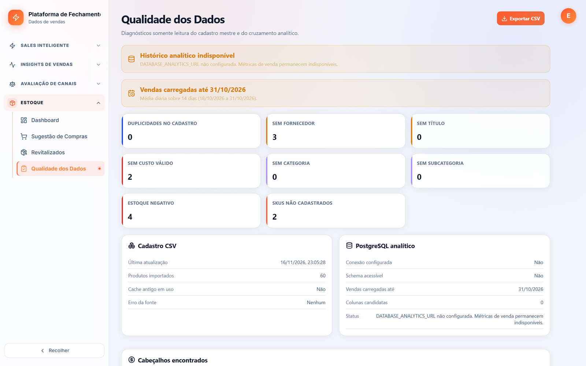

### Fechamento por parceiro comercial

- Painéis para produtos vendidos com ou para um parceiro, com curadoria de SKUs por painel, **custo do parceiro por vigência**, lotes de entrada e conferência de estoque (entrou · vendido · deveria ter · tem hoje).
- Grafias diferentes do mesmo SKU somam vendas e estoque na linha principal, para que nenhuma variante fique sem custo sem aviso.

### Acesso e operação

- Login único para todos os módulos, **permissão por tela validada no servidor**, senha provisória, recuperação por código e pedido de acesso com aprovação do administrador.
- Histórico de execuções com quem enviou, quando, status e motivo da falha em linguagem clara.
- Sincronização diária da planilha de custos e estoque.

---

## Funcionalidades: Dash de Vendas

- **Coleta diária** (uma execução por dia): busca os pedidos de ontem e hoje na API do hub de marketplaces (paginada) e usa as exportações mensais para o histórico, removendo do arquivo os dias que a API vai atualizar.
- **Virada de mês automática**: no dia 1, o mês que fechou passa a vir do relatório mensal completo e a API começa o mês novo.
- **Custos e estoque**: integração OAuth 2.0 com a API do Bling (com renovação de token) ou leitura da planilha de custos publicada. SKUs repetidos no cadastro são consolidados.
- **Shopee**: lê os relatórios compactados e soma cupom e moedas da plataforma, comissão e taxa de serviço por pedido, usando o preço acordado como valor do produto.
- **Padronização**: 20 grafias de loja, 16 status e uma hierarquia de regras para o tipo de logística (fulfillment e Flex têm prioridade sobre a regra da loja).
- **Deduplicação** por pedido + SKU e carga no BigQuery com **schema explícito de 22 campos**.
- **Curva ABC por loja e por mês**, por quantidade e por GMV (A até 80% acumulado, B até 95%, C no restante), também consolidada por canal e para a operação inteira, com uma tabela por loja.
- Diagnóstico de cobertura: para cada loja, lista os meses que existem na base e não têm vendas daquela loja.

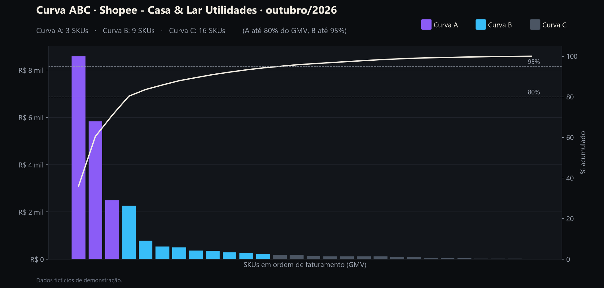

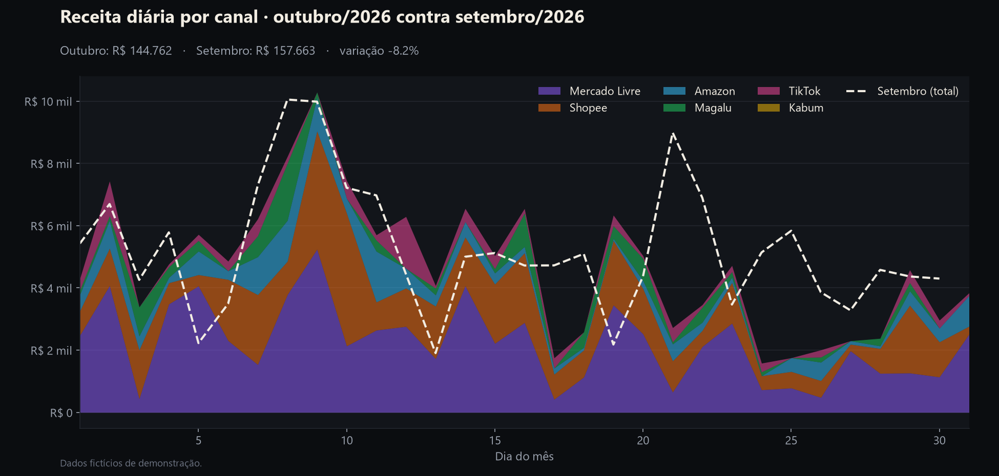

---

## Arquitetura

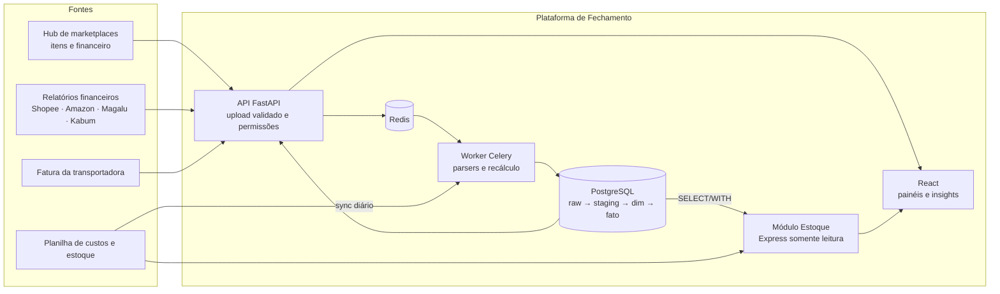

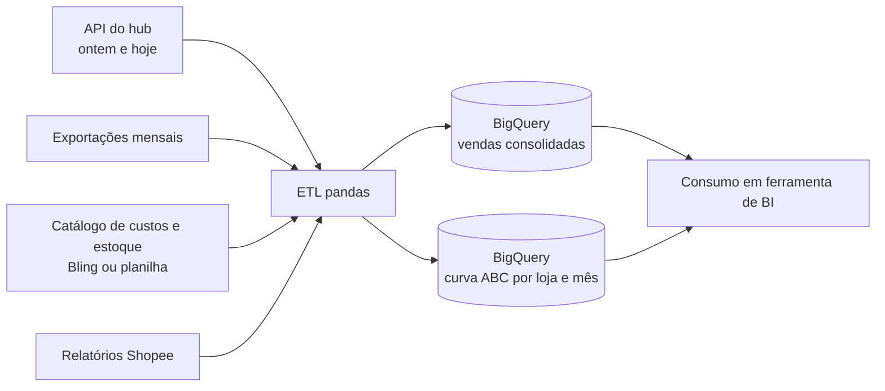

- **API (FastAPI)**: recebe arquivos por streaming com limite de tamanho, valida conteúdo e extensão, protege contra ZIP bomb e path traversal, e só enfileira o processamento.
- **Worker (Celery + Redis)**: interpreta cada formato de relatório, grava as linhas brutas e de staging e recalcula os fatos dentro de uma transação, com trava para que dois recálculos nunca rodem ao mesmo tempo.
- **PostgreSQL + Alembic**: 29 tabelas e 9 migrações. O Alembic é a única autoridade de schema; web e worker não executam DDL.
- **Frontend (React + Vite)**: painéis, filtros com semântica explícita e cache de consultas.
- **Módulo Estoque (Express + TypeScript)**: usa a mesma sessão do sistema principal, consulta os dados apenas com `SELECT`/`WITH` e calcula giro, cobertura e compra sugerida.
- **Dash de Vendas (Python + pandas)**: ETL que consolida as fontes e publica no BigQuery.

### Modelagem de dados

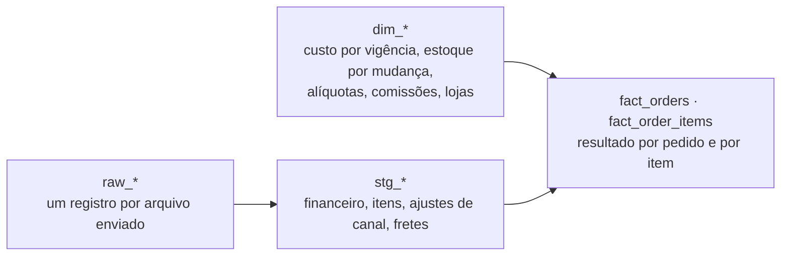

- **raw**: cada arquivo enviado, com origem e hash, é o log de fontes.
- **staging**: dados normalizados por pedido e por item, sem perder a fonte.
- **dimensões com vigência**: custo por data de início, estoque gravado só quando muda, alíquota por loja e modalidade com início e fim, comissão por canal com a base que gerou a média.
- **fatos**: uma linha por pedido e por item, com todos os componentes do lucro em colunas próprias.
- **Grão declarado**: em telas por pedido, filtrar por produto significa "pedidos que contêm o produto"; em relatórios por produto, só os itens filtrados entram no cálculo.

---

## Decisões técnicas

O projeto tem **45 decisões de arquitetura registradas**, com contexto, decisão, consequência e, quando houve, a medição que motivou a mudança. Algumas delas:

1. **Regra financeira é código, não planilha.** Comissão, subsídio, reembolso, frete e imposto ficam num módulo de regras versionado, com teste para cada caso. Quando a regra muda, todo o histórico é recalculado com a mesma lógica.
2. **Otimizar sem mudar um número.** O recálculo completo ficou 3,1× mais rápido (de 145 s para 48 s), trocando só o transporte dos dados. A equivalência foi provada comparando o hash de todas as colunas das tabelas de fato antes e depois.
3. **O padrão seguro fica no backend.** Sem filtro de status, a API exclui pedidos cancelados. Um total financeiro não pode depender de a tela lembrar de enviar um parâmetro.
4. **Excluir sem perder o que veio depois.** Desfazer um envio mexe só nos pedidos daquele arquivo e reaplica os envios restantes na ordem. Se não houver como reconstruir com segurança, a operação é recusada antes de alterar qualquer dado.
5. **Causa nunca é afirmada sem evidência.** "Caiu" e "faltou produto" só são a mesma coisa quando o estoque confirma. Estimativas aparecem rotuladas como estimativas.
6. **A fila não pode derrubar a si mesma.** Concorrência explícita no worker, reconhecimento de mensagem escolhido por tarefa e varredura de execuções presas, para que uma falha de memória custe uma sincronização e não a fila inteira.

## Tecnologias

| Camada | Tecnologias |
|---|---|
| Backend | Python 3.12, FastAPI, SQLAlchemy 2, Pydantic, Alembic |
| Processamento | Celery, Redis, pandas, openpyxl, xlrd |
| Banco de dados | PostgreSQL 16 |
| Frontend | React 18, Vite, TanStack Query, ApexCharts, Tailwind CSS |
| Módulo Estoque | Node.js, Express, TypeScript, Zod, React |
| ETL e analytics | Python, pandas, Google BigQuery, pandas-gbq |
| Infraestrutura | Docker Compose, nginx, Traefik, GitHub Actions |

## Qualidade e segurança

- **Testes automatizados**: 296 testes no backend (pytest, todos passando), 23 no frontend e 27 no módulo Estoque (Vitest). As regras de margem, comissão, reconciliação, parsers, permissões e exclusão de envios têm testes próprios.
- **CI no GitHub Actions**: testes, auditoria de dependências (pip-audit e npm audit), lint e typecheck, migração em banco limpo, build das imagens Docker e varredura de segredos com gitleaks.
- **Sessão e acesso**: cookie HttpOnly com proteção CSRF, token com emissor e audiência, revogação imediata ao sair, trocar senha ou mudar permissões, senha com hash bcrypt, limite de tentativas de login e permissão por tela validada no servidor.
- **Dados pessoais**: as tabelas de pedido guardam loja, SKU, valores e rastreio. Não há nome, documento ou endereço de comprador no modelo.
- **Operação**: backup com restauração verificada antes de cada migração em produção, imagens anteriores marcadas para rollback e erros internos nunca devolvidos ao navegador.

## Status

**Plataforma de Fechamento: em produção**, em uso pela operação e implantada em servidor próprio com Docker, com deploy controlado e rollback documentado.
**Dash de Vendas:** construído antes da plataforma, como base de vendas em BigQuery com curva ABC; distribuído como executável para Windows.

---

Projeto desenvolvido por **Matheus Silva · MFlow**
[mflowstudio.com.br](https://mflowstudio.com.br) · [github.com/portfolio-mflow](https://github.com/portfolio-mflow)

O código-fonte é privado. Demonstração disponível mediante contato.
